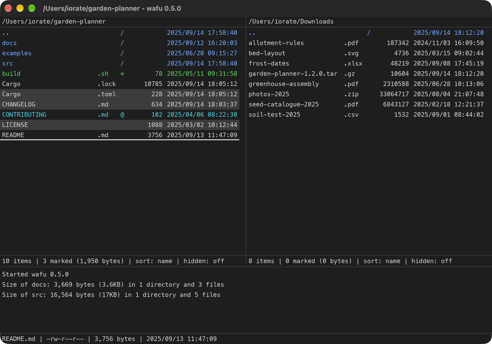
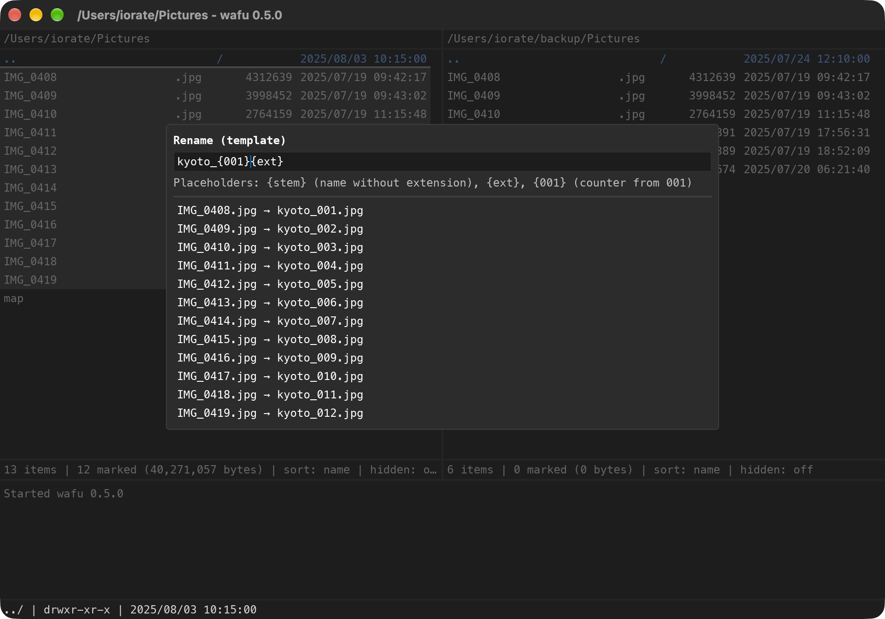
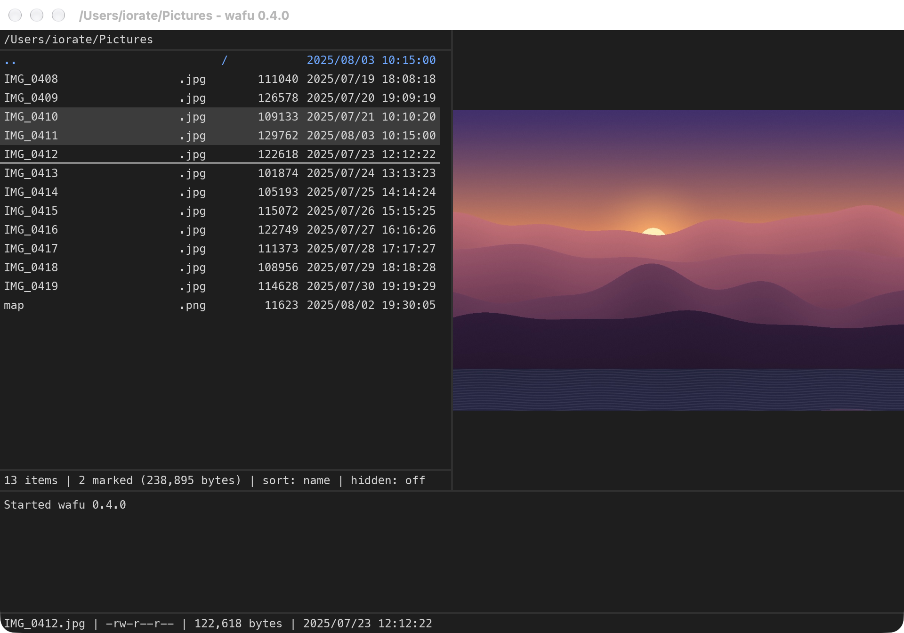

# wafu

A keyboard-driven dual-pane file manager for Windows, macOS, and Linux, built with Rust and Slint. Modeled on [あふｗ](https://afxw.sakura.ne.jp/).



## Features

- **Everything from the keyboard.** Most commands are a single key, and <kbd>F1</kbd> lists the commands with their keys.
- **Quick navigation.** Incremental search, glob filters, recursive find by name, per-pane history, and bookmarks.
- **Archives open like directories.** Browse, preview, and extract zip and tar archives, including archives inside archives.
- **Batch rename with a live preview.** Rename the marked files by find and replace or from a template with a counter, and see every new name before it is applied.
- **Image and text previews.** An image is shown beside the file list and follows the cursor. Any file can be opened as text or as a hex dump.





## Installation

### Windows

Install with [Scoop](https://scoop.sh):

```sh
scoop bucket add iorate https://github.com/iorate/scoop-bucket
scoop install iorate/wafu
```

### macOS

Install with [Homebrew](https://brew.sh) (Apple silicon only):

```sh
brew install iorate/tap/wafu
```

This installs the `wafu` command and `wafu.app`. `brew info iorate/tap/wafu` shows where the app is and how to put it in `Applications`.

### Linux

Install with [Homebrew](https://brew.sh) (x86-64 only):

```sh
brew install iorate/tap/wafu
```

The binary needs glibc 2.28 or later and uses the libraries of the host: fontconfig, xkbcommon, Wayland or X11, and EGL or OpenGL.

The directory dialog of `browse` needs an XDG Desktop Portal backend with a file chooser (GTK, GNOME, or KDE) or, failing that, `zenity`.

### Cargo

On any of the three, wafu can be built from source instead:

```sh
cargo install --locked wafu
```

On Linux, install the build dependencies first. On Debian and Ubuntu:

```sh
sudo apt install libxcb-shape0-dev libxcb-xfixes0-dev libxkbcommon-dev libxkbcommon-x11-dev libfontconfig-dev libwayland-dev
```

## Configuration

Settings, colors, bookmarks, external commands, and key bindings live in a TOML file, which is reloaded when it is saved. See [docs/configuration.md](https://github.com/iorate/wafu/blob/main/docs/configuration.md).

## Acknowledgments

The user interface is built with [Slint](https://slint.dev).

[](https://slint.dev)

## License

Licensed under either of

- Apache License, Version 2.0 ([LICENSE-APACHE](LICENSE-APACHE) or <http://www.apache.org/licenses/LICENSE-2.0>)
- MIT license ([LICENSE-MIT](LICENSE-MIT) or <http://opensource.org/licenses/MIT>)

at your option.
